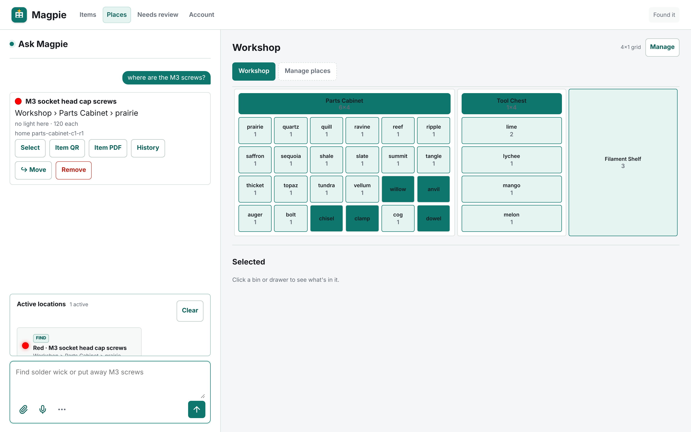
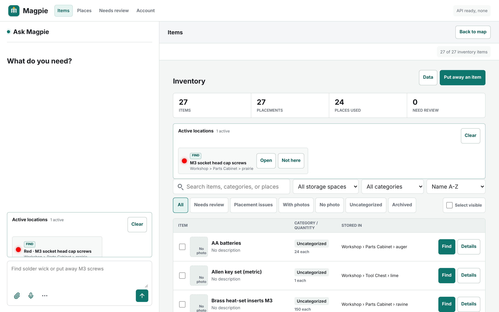
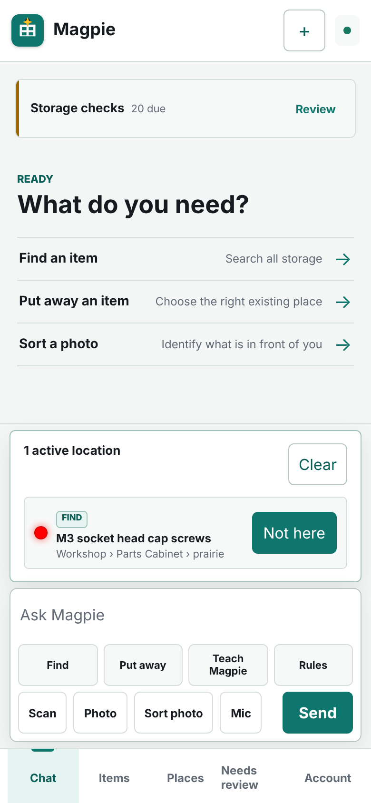
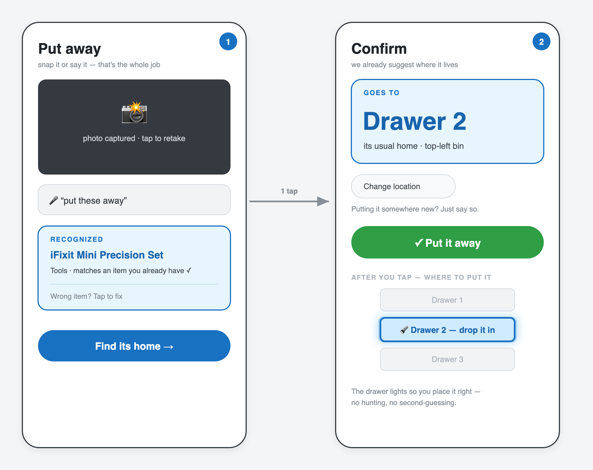
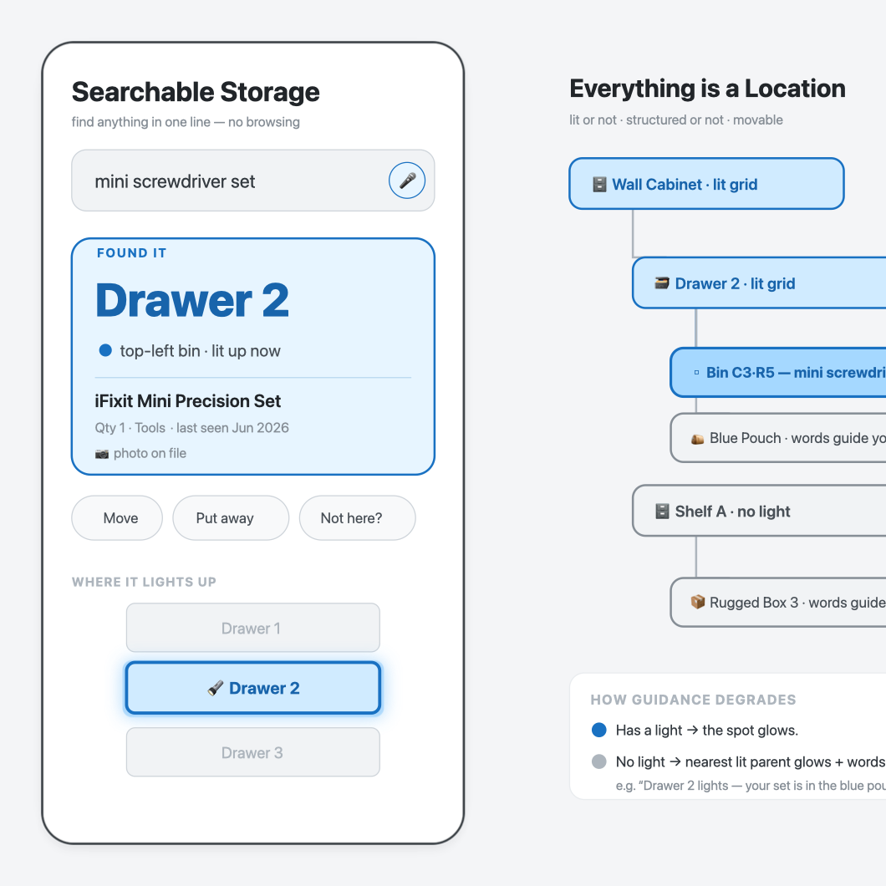

# Magpie

**An AI-run storage manager for the home and workshop.** Snap a photo or just say
"put these away," and Magpie figures out what the thing is, where it belongs, and
lights up the drawer. Ask "where's the hot glue gun?" and the right bin glows.

Magpie keeps one searchable graph of every storage place, nested container, item,
photo, label, and learned placement rule. Raspberry Pi edge devices plug the
physical world into that graph: microphones and speakers for voice, cameras and
check stations for intake, Zebra label printers for QR labels, and addressable
LED strips that light the exact bin you need.

- **Confirmation-first AI agent.** Find, put away, move, and reorganize with text,
  photos, or voice. Magpie proposes; you confirm or correct, and it learns your
  rules ("jewelry always goes in the main cabinet").
- **Physical feedback.** LED-lit cabinets, kiosk screens, and printed QR labels
  close the loop between the database and the drawer.
- **Built to be shared.** Multi-user workspaces on Supabase auth with row-level
  security, plus an MCP server so other AI agents can query and update storage.

The product is software-first: the web and mobile app work with zero hardware.
Optional edge devices add voice, kiosk displays, cameras, printers, and lights
without becoming separate inventory systems.

## Screenshots

Real UI from a local demo run with synthetic workshop data. No AI keys, no hardware: the cabinet lights are simulated.

**Ask where something is.** Magpie answers with the exact bin and lights it up (highlighted on the map).



| Inventory | Mobile |
|---|---|
|  |  |

<details>
<summary>Early design concepts</summary>

| Put-away flow | Assistant interface |
|---|---|
|  |  |

</details>

## Architecture

```text
 Phone / browser            Raspberry Pi edge devices
 (web + PWA)                (voice, kiosk, camera, label printer, LEDs)
      │                              │  outbound-only, token-authenticated
      ▼                              ▼
 ┌──────────────────────────────────────────────┐
 │  Magpie central service (FastAPI, Docker)     │
 │  • storage graph: places → containers → items │
 │  • AI agent loop: vision, speech, tool calls  │
 │  • labels / QR, placement rules, review queue │
 │  • MCP server for external agents             │
 └──────────────────────┬───────────────────────┘
                        ▼
        Supabase (Postgres + auth + storage, RLS)
```

- **Central service** (`src/searchable_storage_led/`): FastAPI app serving the
  web UI, REST API, assistant, and MCP server. Ships as a container.
- **Data** (`supabase/migrations/`): Postgres schema with row-level security,
  workspaces, and edge-device credentials.
- **Edge** (`scripts/install-pi5-led-service.sh`, `config/`): Pi services for
  WLED/WS2812 lighting, voice capture (Vosk + VAD), kiosk display, and Zebra
  printing, each connecting outbound to the central service.
- **Hardware** (`3D-Models/`): Fusion 360, STL, and 3MF files for the drawer and
  cabinet system.

## Run Magpie Locally

```bash
docker compose up --build -d
curl http://127.0.0.1:8766/ready
```

Open the Assistant at `http://127.0.0.1:8766/` and storage management at
`http://127.0.0.1:8766/storage`. See
[`docs/container-deployment.md`](docs/container-deployment.md) for hosted
Supabase authentication, immutable releases, and secure edge-controller setup,
and [`docs/operations.md`](docs/operations.md) for LED, Pi, and voice setup.

Run the tests:

```bash
python -m venv .venv && .venv/bin/pip install -e '.[test]' webrtcvad-wheels vosk
.venv/bin/python -m pytest
```

## License

MIT, see [LICENSE](LICENSE).
